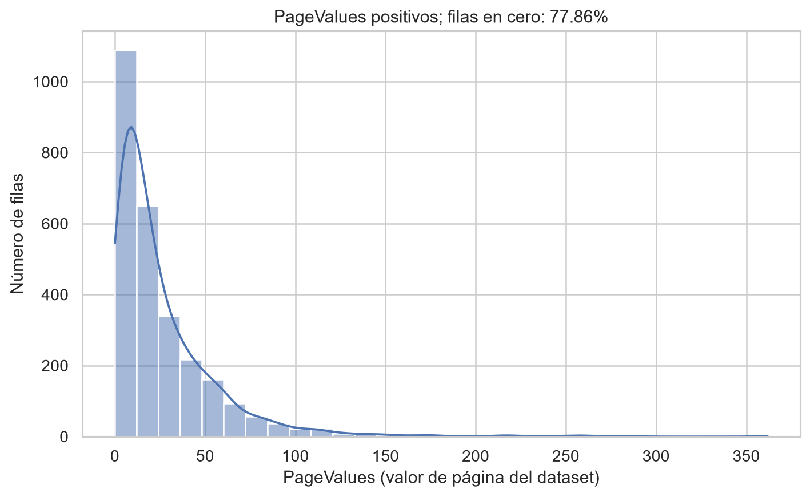
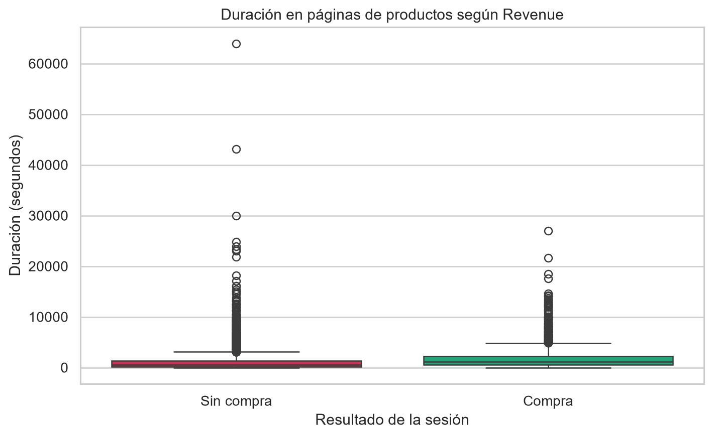
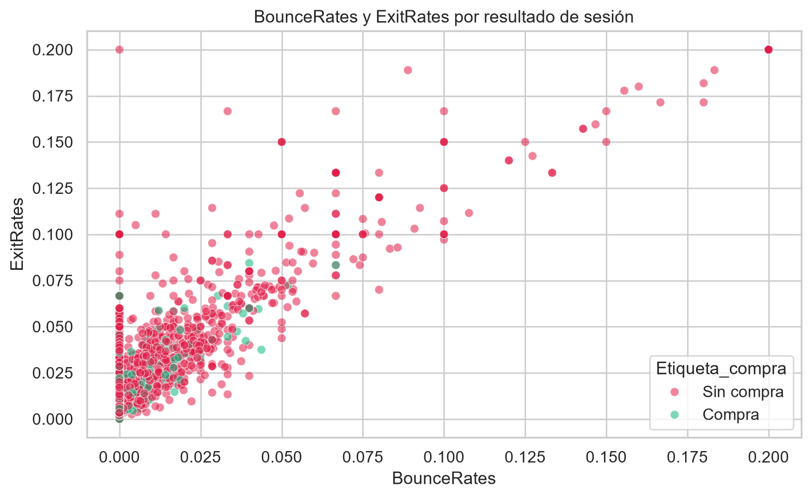
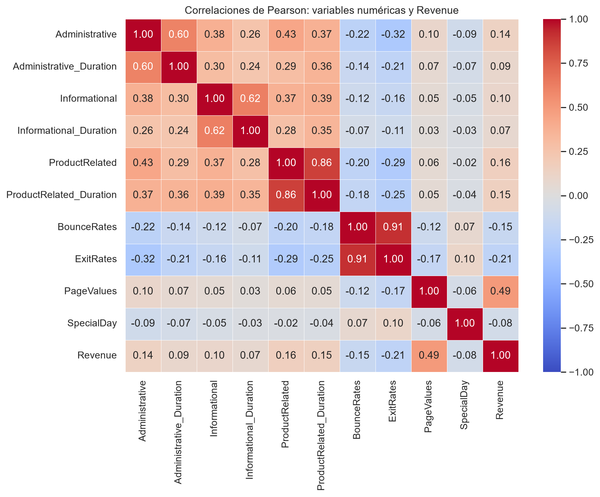
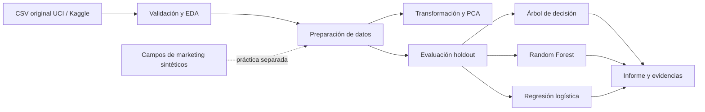
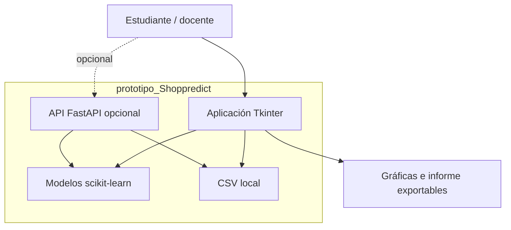

# Minería De Datos EDA – Proyecto Shoppredict

**Informe actualizado para la segunda entrega**<br>
**Curso:** Minería de Datos · Ingeniería de Sistemas · UNIMINUTO · 2026<br>
**Equipo:** Milton Cesar Machado Barreto · Raúl Andrés Triana Ortega · Santiago Molina Maldonado

> Este Markdown organiza el informe entregado en Word y PDF y deja trazable cómo
> reproducir las visualizaciones. Las cifras de abajo se contrastaron con el CSV
> distribuido en `prototipo_Shoppredict/`; donde el informe fuente usa campos
> simulados o cifras que no se reproducen con ese CSV, se señala explícitamente.

## 1. Contexto y objetivo

**Pregunta de análisis:** ¿qué patrones del comportamiento observado durante una
sesión de navegación se relacionan con `Revenue` (compra o no compra)?

El trabajo aplica la fase de comprensión y exploración de datos de CRISP-DM para
describir distribuciones, relaciones entre variables y calidad del conjunto antes
del modelado. Es un análisis académico: las asociaciones observadas no prueban
causalidad ni garantizan decisiones de negocio.

## 2. Dataset y calidad

El archivo incluido es `online_shoppers_intention.csv`, con sesiones de comercio
electrónico y la variable objetivo `Revenue`.

| Comprobación reproducible | Resultado |
|---|---:|
| Filas del CSV original | 12.330 |
| Columnas, incluida `Revenue` | 18 |
| Valores faltantes | 0 |
| Duplicados exactos | 125 |
| Sesiones con compra (`True`) | 1.908 (15,47 %) |
| Sesiones sin compra (`False`) | 10.422 (84,53 %) |

Las 12.330 filas son el tamaño del archivo antes de excluir duplicados; no deben
describirse como 12.330 sesiones únicas. La aplicación excluye los 125 duplicados
exactos al preparar la evaluación de modelos.

### Procedencia

- [Ficha original de UCI, conjunto 468](https://archive.ics.uci.edu/dataset/468/online+shoppers+purchasing+intention+dataset), DOI `10.24432/C5F88Q`.
- [Distribución en Kaggle atribuida a Akash Patel](https://www.kaggle.com/datasets/imakash3011/online-shoppers-purchasing-intention-dataset).
- El descargador opcional consulta UCI mediante `ucimlrepo`; no utiliza credenciales
  de Kaggle ni reemplaza el archivo local.

## 3. Exploración reproducible

Las figuras se generan con
[`reproducir_graficos_eda.py`](./reproducir_graficos_eda.py), usando el CSV
incluido. Para repetirlas en Windows:

```powershell
cd .\Promp_Maestro
python -m pip install -r .\prototipo_Shoppredict\requirements.txt
python .\reproducir_graficos_eda.py
```

La carpeta `evidencias/eda/` recibe los PNG. En GitHub, las imágenes de esta
sección se muestran directamente:

### Figura 1. Distribución de `PageValues`



En el CSV, 77,86 % de las filas tiene `PageValues = 0`. Entre las filas con un
valor positivo, 56,34 % tiene `Revenue = True`. `PageValues` se define en el
dataset como un valor de página; no se debe rotular como USD sin una fuente que
justifique esa unidad.

### Figura 2. Duración en páginas de productos según `Revenue`



La mediana de `ProductRelated_Duration` es 510,19 segundos en sesiones sin compra
y 1.109,91 segundos en sesiones con compra. Es una asociación descriptiva, no un
umbral causal de conversión.

### Figura 3. Tasa por canal de origen (campo sintético)

El informe fuente presenta `Canal_Origen` y tasas por canal, pero esa columna no
está en el CSV original incluido. El script solo genera esta gráfica si recibe un
CSV que contenga la columna; además, la etiqueta como **sintética**. Las tasas
citadas en el Word/PDF no se reproducen a partir del archivo distribuido y no
deben presentarse como resultados de canales o campañas reales.

### Figura 4. Relación entre `BounceRates` y `ExitRates`



La correlación de Pearson calculada sobre el CSV original es **0,913**. El valor
`r = 0,76` que aparece en el Word/PDF no coincide con esta versión del archivo.

### Figura 5. Correlaciones de variables numéricas



La correlación de Pearson entre `PageValues` y `Revenue` codificada como 0/1 es
**0,493** en el CSV incluido. La correlación describe asociación; no prueba que
`PageValues` cause la compra.

## 4. Aclaraciones sobre el informe Word/PDF

La versión Word/PDF se conserva como evidencia de la entrega. Para la lectura
reproducible de este paquete se deben tener en cuenta estas diferencias:

1. El informe llama “sesiones únicas” a 12.330 filas, aunque el archivo contiene
   125 duplicados exactos.
2. El informe reporta 84 % de `PageValues` en cero, conversión superior a 65 %
   para valores positivos y `r = 0,76` entre `BounceRates` y `ExitRates`. El CSV
   incluido produce, respectivamente, 77,86 %, 56,34 % y `r = 0,913`.
3. `Canal_Origen`, `Cupon_Aplicado`, `Nivel_Fidelidad` y `Gasto_Historico_USD`
   son campos sintéticos que no están en el CSV original. No sustentan
   conclusiones sobre usuarios, campañas o ventas reales.
4. `PageValues` puede contener información conocida al finalizar la sesión. Antes
   de usarla en una predicción en tiempo real debe verificarse que esté disponible
   en el instante de decisión; de lo contrario puede introducir fuga de
   información.

El script conserva los datos originales para las figuras y no inventa canales
cuando el campo no está disponible. Si se usa otra versión del CSV, vuelve a
generar las figuras y actualiza las cifras asociadas.

## 5. Preparación, transformación y modelado

El material complementario documenta limpieza e integración demostrativa,
estandarización, codificación categórica, discretización y PCA. Los flujos de
transformación parten de conjuntos con campos sintéticos y deben diferenciarse de
la evaluación de la GUI, que utiliza por defecto el CSV original.

La evaluación guardada de la aplicación excluyó 125 duplicados exactos y aplicó
una partición estratificada 80/20 con semilla 42 (9.764 registros de
entrenamiento y 2.441 de prueba):

| Modelo | Accuracy | Balanced accuracy | Precision | Recall | F1 | ROC-AUC |
|---|---:|---:|---:|---:|---:|---:|
| Árbol de decisión | 0,8574 | 0,7407 | 0,5423 | 0,5707 | 0,5561 | 0,7407 |
| Random Forest | 0,9029 | 0,7548 | 0,7715 | 0,5393 | **0,6348** | 0,9248 |
| Regresión logística | 0,8873 | 0,6944 | 0,7560 | 0,4136 | 0,5347 | 0,8997 |

Random Forest obtuvo el mayor F1 **en esa partición**. Este resultado no es una
garantía de rendimiento futuro, no prueba causalidad y no acredita desempeño en
producción.

## 6. Diagramas del flujo

GitHub representa los siguientes diagramas Mermaid al abrir este Markdown.

### Flujo del análisis



### Componentes de la demo



## 7. Aplicación y material de entrega

- [`../../README.md`](../../README.md): guía operativa de la entrega.
- [`prototipo_Shoppredict/`](./prototipo_Shoppredict/): aplicación, API opcional,
  dataset, dependencias y lanzadores de Windows.
- [`ShopPredict Intención de Compra.pptx`](./ShopPredict%20Intención%20de%20Compra.pptx):
  presentación de la segunda entrega y sus recursos visuales.
- [Prompt maestro](./promp_maestro_Shoppredict.md): guía para organizar la
  exposición después de este informe.
- [Módulo 01: datos y limpieza](./promp_sub_01_datos_y_limpieza.md).
- [Módulo 02: transformación y PCA](./promp_sub_02_transformacion_y_pca.md).
- [Módulo 03: aplicación y modelos](./promp_sub_03_aplicacion_y_modelos.md).

Para iniciar la GUI desde la raíz del repositorio:

```powershell
python -m pip install -r .\Promp_Maestro\prototipo_Shoppredict\requirements.txt
python .\Promp_Maestro\prototipo_Shoppredict\app_shoppredict_gui.py
```

La GUI carga automáticamente el CSV que está junto al programa. La API y la
descarga desde UCI son componentes opcionales; no hacen falta para la demo local.
