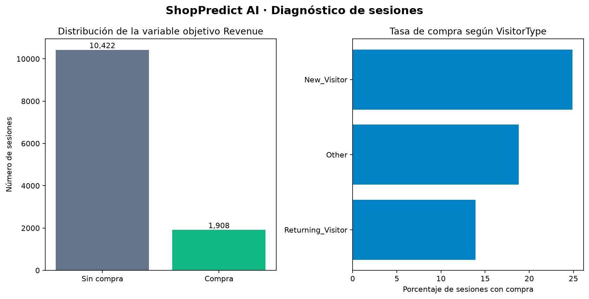
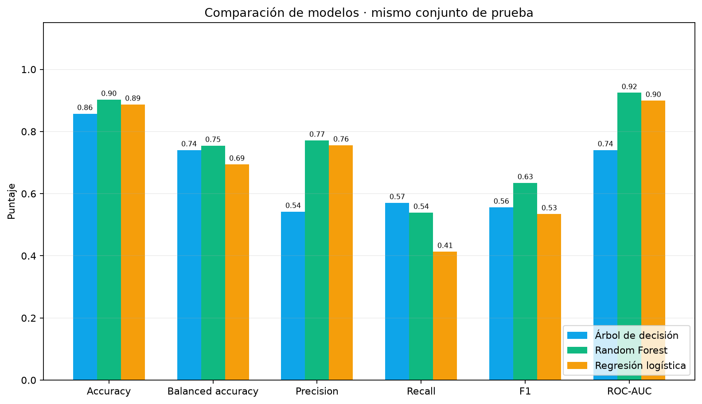
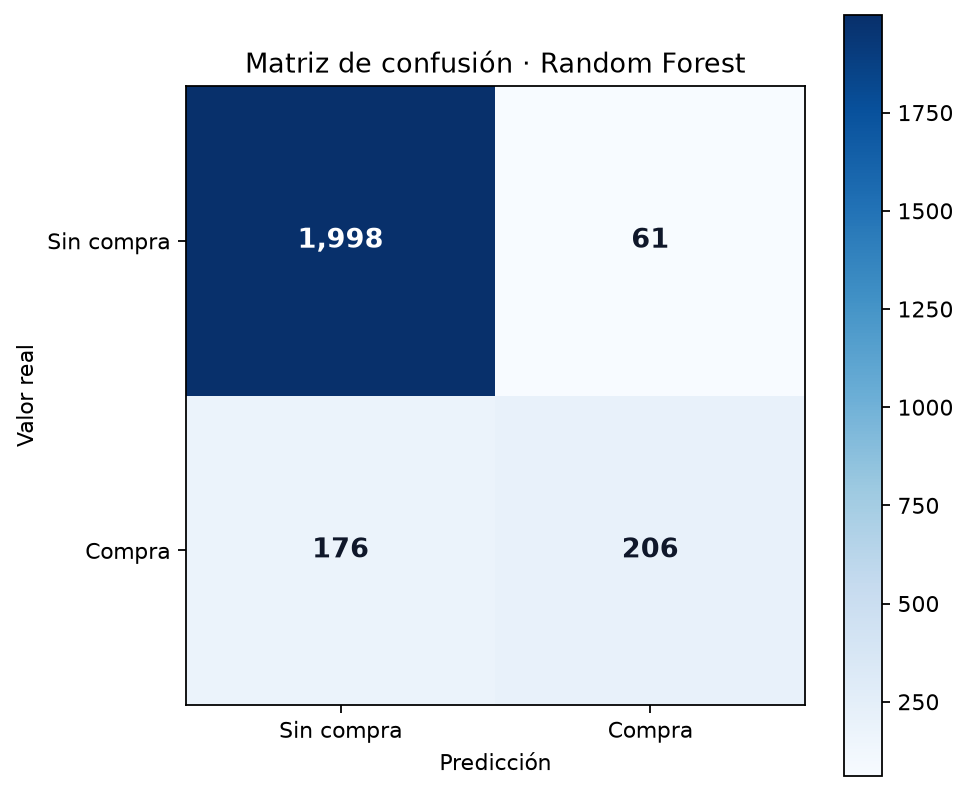
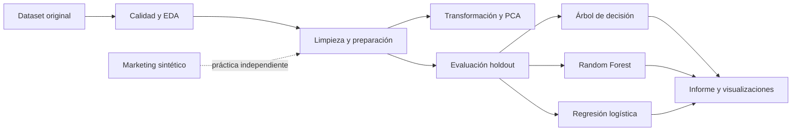
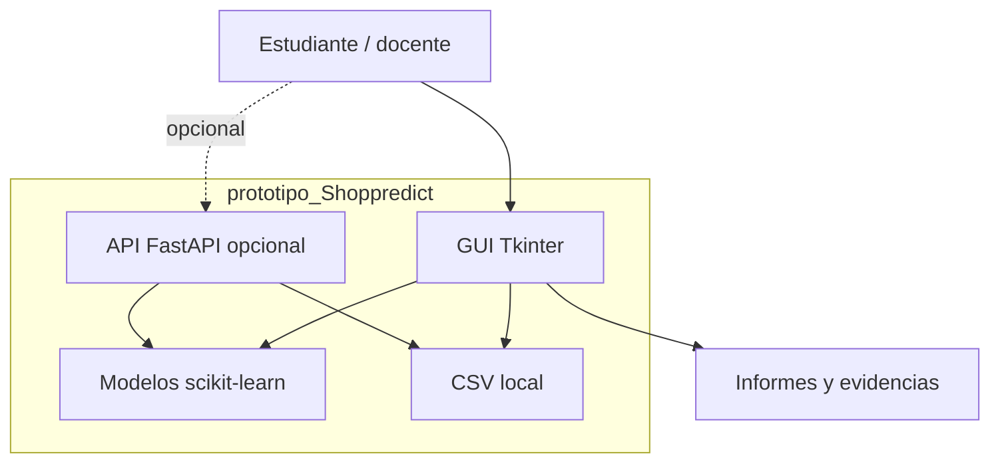

<div align="center">

# ShopPredict AI
### Análisis de intención de compra en sesiones de comercio electrónico

**Proyecto académico de Minería de Datos**<br>
Python · Tkinter · scikit-learn · FastAPI

</div>

> ShopPredict AI explora si las características de una sesión de navegación
> permiten estimar si un visitante realizó una compra. Este paquete reúne la
> aplicación, datos de demostración, evidencias, servicios opcionales y material
> de presentación para abrirlo y recorrerlo desde VS Code.

**Equipo:** Milton Cesar Machado Barreto · Raúl Andrés Triana Ortega · Santiago Molina Maldonado

---

## Contenido

- [El proyecto](#el-proyecto)
- [Resultados documentados](#resultados-documentados)
- [Recorrido visual](#recorrido-visual)
- [Diagramas Mermaid](#diagramas-mermaid)
- [Arquitectura del paquete](#arquitectura-del-paquete)
- [Inicio rápido](#inicio-rápido)
- [Informe EDA y visualizaciones](#informe-eda-y-visualizaciones)
- [Fuentes y datos](#fuentes-y-datos)
- [Alcance y limitaciones](#alcance-y-limitaciones)
- [Presentación](#presentación)

## El proyecto

El objetivo del proyecto es estudiar la etiqueta `Revenue` —compra o no compra—
usando atributos de navegación y contexto de sesión. El flujo reúne exploración,
preparación, transformación, comparación de clasificadores y una aplicación
gráfica para revisar los resultados.

| Componente | Qué hace |
|---|---|
| **Aplicación de escritorio** | Carga el CSV, presenta resúmenes y gráficos, evalúa clasificadores y exporta informe y evidencias. |
| **Modelos** | Compara Árbol de Decisión, Random Forest y Regresión Logística. |
| **API REST opcional** | Expone metadatos, esquema de entrada y predicción desde un servicio independiente de la GUI. |
| **Descarga UCI opcional** | Obtiene otra copia del dataset y metadatos de procedencia; requiere Internet. |
| **Material de exposición** | Prompt maestro y tres módulos para explicar datos, transformación, aplicación y modelos. |

## Resultados documentados

En la corrida guardada, después de excluir **125 duplicados exactos**, se utilizó
una partición estratificada **80/20** con semilla **42** (**9.764 filas de
entrenamiento y 2.441 de prueba**). **Random Forest alcanzó el mayor F1 de esa
partición**:

| Métrica | Resultado |
|---|---:|
| F1 | **0,6348** |
| Accuracy | 0,9029 |
| Balanced accuracy | 0,7548 |
| Precision | 0,7715 |
| Recall | 0,5393 |
| ROC-AUC | 0,9248 |

Son valores de una corrida académica guardada, no una garantía de rendimiento
futuro, causalidad, aumento de ventas ni desempeño en producción. Consulta el
informe y las métricas exportadas en `evidencias/`.

## Recorrido visual

Las visualizaciones exportadas permiten mostrar la exploración, la comparación
de modelos y los errores de clasificación:

| Diagnóstico del dataset | Comparación de modelos |
|---|---|
|  |  |

**Matriz de confusión del modelo con mayor F1 en la corrida guardada:**



Las visualizaciones EDA tienen código reproducible y se muestran en el
[informe actualizado](./Minería%20De%20Datos%20EDA%20%E2%80%93%20Proyecto%20Shoppredict%20-%20Actualizado.md).

## Diagramas Mermaid

GitHub representa estos diagramas desde el propio Markdown; no dependen de
capturas externas ni de complementos.

### Flujo del proyecto



### Componentes de ShopPredict



## Arquitectura del paquete

```text
Promp_Maestro/
├── evidencias/                     # Informe, métricas y visualizaciones
│   └── eda/                        # Gráficas EDA reproducidas desde el CSV
├── prototipo_Shoppredict/          # Aplicación autocontenida para la demo
│   ├── app_shoppredict_gui.py      # Interfaz gráfica de escritorio
│   ├── shoppredict_model.py        # Lógica compartida de modelos
│   ├── api_shoppredict.py          # API REST opcional (FastAPI)
│   ├── descargar_dataset_uci.py    # Descarga opcional desde UCI
│   ├── descargar_dataset_uci.bat
│   ├── online_shoppers_intention.csv
│   ├── iniciar_app.bat
│   ├── iniciar_api.bat
│   └── requirements.txt
├── reproducir_graficos_eda.py      # Código fuente de las figuras del informe
├── Minería De Datos EDA – Proyecto Shoppredict - Actualizado.md
├── Minería De Datos EDA – Proyecto Shoppredict - Actualizado.docx
├── Minería De Datos EDA – Proyecto Shoppredict - Actualizado.pdf
├── ShopPredict Intención de Compra.pptx
├── promp_maestro_Shoppredict.md    # Guion principal de presentación
├── promp_sub_01_datos_y_limpieza.md
├── promp_sub_02_transformacion_y_pca.md
└── promp_sub_03_aplicacion_y_modelos.md
```

El ZIP no se genera automáticamente. Para entregar el paquete, comprime la
carpeta `Promp_Maestro` completa desde el Explorador de archivos.

## Inicio paso a paso en Windows y VS Code

> La aplicación y sus dependencias están juntas en
> `Promp_Maestro\prototipo_Shoppredict`. No necesitas iniciar la API para abrir
> la ventana.

1. Abre VS Code y selecciona **Archivo → Abrir carpeta...**. Elige la carpeta
   `Promp_Maestro\prototipo_Shoppredict` dentro del proyecto.
2. Abre **Terminal → Nueva terminal**. Comprueba que la terminal está dentro de
   `prototipo_Shoppredict`, donde aparecen `app_shoppredict_gui.py`,
   `requirements.txt` y `online_shoppers_intention.csv`.
3. Instala las dependencias una sola vez:

   ```powershell
   python -m pip install -r .\requirements.txt
   ```

4. Inicia la aplicación gráfica:

   ```powershell
   python .\app_shoppredict_gui.py
   ```

5. Debe abrirse la ventana **ShopPredict AI**. El dataset incluido se carga
   automáticamente. Para evaluar los modelos, pulsa **“2. Entrenar y evaluar”**.

### Si abriste la carpeta raíz del repositorio

Si la terminal de VS Code muestra que estás en
`ProyectoMineriaDeDatos`, ejecuta:

```powershell
python -m pip install -r .\Promp_Maestro\prototipo_Shoppredict\requirements.txt
python .\Promp_Maestro\prototipo_Shoppredict\app_shoppredict_gui.py
```

### Inicio con doble clic

También puedes abrir `Promp_Maestro\prototipo_Shoppredict\iniciar_app.bat` con
doble clic. Si algo falla, inicia el `.bat` desde la terminal para que el
mensaje de error no se cierre con la ventana.

### Si no aparece la ventana

- Confirma que ejecutaste `app_shoppredict_gui.py`, no `api_shoppredict.py`.
- Comprueba la carpeta actual con `Get-Location` y lista sus archivos con
  `Get-ChildItem`. Debes ver el script y `requirements.txt`.
- Si aparece `ModuleNotFoundError`, repite la instalación de dependencias del
  paso 3 y vuelve a ejecutar el comando.
- No cierres la terminal: copia el mensaje de error completo para poder
  identificar la causa. Ejecutar un `.py` con doble clic puede cerrar la
  consola antes de que alcances a leerlo.

### API REST opcional

Abre una segunda terminal en `prototipo_Shoppredict` y ejecuta:

```powershell
.\iniciar_api.bat
```

Consulta la documentación interactiva en
<http://127.0.0.1:8000/docs>. La API es independiente de la GUI; sus predicciones
demostrativas no son una evaluación independiente. Para detener el servicio,
usa `Ctrl+C` en la terminal donde está activo.

### Descargar otra copia desde UCI

El descargador es opcional y necesita Internet. Ejecuta
`.\descargar_dataset_uci.bat` desde `prototipo_Shoppredict`; crea
`online_shoppers_intention_uci.csv` y
`online_shoppers_intention_uci.metadata.json` sin reemplazar el CSV incluido.
El descargador consulta UCI, no la API de Kaggle.

## Informe EDA y visualizaciones

El informe actualizado basado en los archivos Word y PDF está en
[`Minería De Datos EDA – Proyecto Shoppredict - Actualizado.md`](./Minería%20De%20Datos%20EDA%20%E2%80%93%20Proyecto%20Shoppredict%20-%20Actualizado.md).
Incluye diagramas Mermaid que GitHub renderiza y enlaza las figuras reproducibles.

También se conservan los documentos originales de la entrega:

- [Informe Word](./Minería%20De%20Datos%20EDA%20%E2%80%93%20Proyecto%20Shoppredict%20-%20Actualizado.docx).
- [Informe PDF](./Minería%20De%20Datos%20EDA%20%E2%80%93%20Proyecto%20Shoppredict%20-%20Actualizado.pdf).
- [Presentación PowerPoint](./ShopPredict%20Intención%20de%20Compra.pptx).

Para regenerar las gráficas EDA desde el CSV:

```powershell
python .\reproducir_graficos_eda.py
```

El script guarda las figuras en `evidencias\eda`. No inventa `Canal_Origen` si
el CSV no lo contiene: las cifras por canal del Word/PDF pertenecen a campos
sintéticos y no deben presentarse como resultados de marketing real.

En la distribución incluida, el CSV tiene 12.330 filas, 18 columnas, 0 valores
faltantes y 125 duplicados exactos. El informe actualizado explica las
diferencias observadas en cifras de algunas figuras del Word/PDF y conserva los
documentos originales como evidencia de la segunda entrega.

## Fuentes y datos

- **Kaggle:** distribución del conjunto atribuida a Akash Patel — [Online Shoppers Purchasing Intention Dataset](https://www.kaggle.com/datasets/imakash3011/online-shoppers-purchasing-intention-dataset).
- **UCI:** ficha original, dataset 468, DOI `10.24432/C5F88Q` — [Online Shoppers Purchasing Intention Dataset](https://archive.ics.uci.edu/dataset/468/online+shoppers+purchasing+intention+dataset).
- **Artículo relacionado:** DOI `10.1007/s00521-018-3523-0`; referencia de contexto, no resultado experimental de ShopPredict.

El CSV original documentado contiene **12.330 filas, 18 columnas, 0 faltantes,
125 duplicados exactos y 1.908 compras (15,47 %)**. La integración demostrativa
documentada produce 12.205 filas y 23 columnas; sus campos de marketing son
sintéticos y no intervienen en la evaluación actual de la GUI.

## Alcance y limitaciones

- La interfaz gráfica conserva su diseño y funciona localmente con el CSV; no
  llama a la API REST.
- La descarga desde UCI requiere conexión, pero no es necesaria para la
  demostración con el dataset incluido.
- La API entrena con las filas etiquetadas disponibles para mostrar inferencia;
  sus respuestas no reemplazan la evaluación holdout.
- La evaluación guardada corresponde a una partición. Como mejora futura se
  puede evaluar estabilidad con varias particiones o validación cruzada y revisar
  qué atributos estarían disponibles al momento de predecir.
- La integración de marketing es sintética y se usa como práctica de preparación,
  no como evidencia de negocio.

## Presentación

Empieza por el [informe EDA actualizado](./Minería%20De%20Datos%20EDA%20%E2%80%93%20Proyecto%20Shoppredict%20-%20Actualizado.md).
Después usa el [prompt maestro](promp_maestro_Shoppredict.md), que organiza la
exposición en nueve diapositivas para coincidir con el PowerPoint, y complétalo
con los módulos de
[datos y limpieza](promp_sub_01_datos_y_limpieza.md),
[transformación y PCA](promp_sub_02_transformacion_y_pca.md) y
[aplicación y modelos](promp_sub_03_aplicacion_y_modelos.md). La presentación
PowerPoint incluida contiene el material visual de sustentación; el límite de
código propuesto para las diapositivas es **30–40 líneas en total**.

Para exponer desde VS Code: abre esta carpeta, presenta este README como portada
del proyecto, revisa el informe y la presentación, muestra los prompts y la
estructura del paquete, y luego ejecuta `prototipo_Shoppredict\iniciar_app.bat`.
